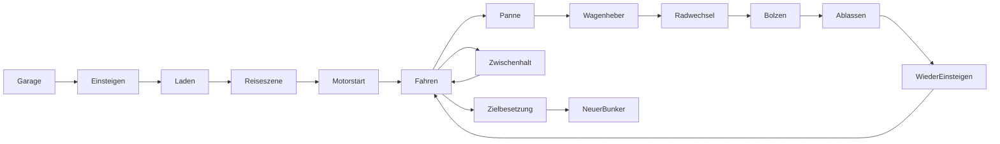

# Kampagne, Forschung und Konvoi

## Ziel und Spielfluss

Die Region wird durch ein wiederhergestelltes Warnnetz verbunden. **Alle acht Bunker und vier strategischen Außenposten müssen gesichert sein.** Ein Besuch zählt nicht als Abschluss. Kleine Versorgungs- und Waffenhalte sind freiwillig. Das Abschlussbild zeigt den Kampagnensieg, sobald der zwölfte Pflichtort gesichert ist; der Fortschritt bleibt gespeichert.

1. **Verteidigen:** Den ersten Bunker ausbauen und 20 Wellen überstehen. Vor der bestätigten letzten Welle wird kein Fahrzeug freigeschaltet.
2. **Vorbereiten:** Übrige Kistenvorräte, getragene Materialien, Maschineninhalte und geborgene Rohstoffe bilden das endliche Garagenlager. Ohne freien Kistenplatz bleibt der Rest als Lagerreserve erhalten und füllt erreichbare Kisten beim Entnehmen nach (10.000 je physischer Kiste, größere Gesamtmengen ohne zusätzliche Kisten in der Reserve; validiert bis zur exakten JSON-Ganzzahlgrenze von 2⁵³−1). Fahrzeug erforschen, reparieren, betanken und beladen.
3. **Route wählen:** Die Einsatzkarte zeigt gesicherte Orte, erreichbare Ziele und die Kosten verschlüsselter Nebenrouten. Bereits gesicherte Elternorte halten ihre Abzweige offen; die Reihenfolge der vier Außenposten ist frei.
4. **Einsteigen und laden:** „Crew einsteigen lassen“ lässt die Crew in der bestehenden Garage zum Wagen gehen. E besetzt einen freien Sitz. Der Wagen bleibt gebremst; M bricht das Einsteigen ab. Erst wenn alle verbundenen lebenden Figuren sitzen und ein Fahrer bereit ist, läuft ein 1,2-Sekunden-Countdown. Danach werden Fortschritt und gewählte Sitzrollen übernommen und die echte Fahrstrecke geladen. Eine kurze Reiseszene und anschließend der bestehende 0,8-Sekunden-Motorstart gehen der Bewegung voraus.
5. **Fahren:** Ein Spieler fährt; bis zu drei weitere besetzen den Mitfahr-/MG-Platz sowie Heck- und Seitenwache. Aussteigen, Rollenwechsel und Verteidigung zu Fuß sind möglich. Alleine kann der Fahrer gleichzeitig lenken und das unbesetzte MG bedienen. Vor dem Einsteigen muss die Crew verwendbare persönliche oder MG-Munition besitzen.
6. **Panne und Sicherung:** Auf passenden Routen platzt bei 35 % Strecke ein Reifen. Der Fahrer steigt an der erreichbaren Hinterradstelle aus. Ein Spieler arbeitet, die anderen halten eine begrenzte Gegnergruppe ab. Erst nach vollständig montiertem Rad und erneutem Einsteigen darf der Wagen weiterfahren.
7. **Zwischenhalt:** Ein gewählter Halt wird von einer begrenzten Gegnergruppe verteidigt. Erst nach deren Niederlage wird die einmalige Belohnung geborgen.
8. **Übernehmen:** Am Ziel muss die verbliebene Besatzung ausgeschaltet werden. Im normalen Bunker wird die Fracht eingelagert und Welle 1 beginnt.
9. **Außenposten sichern:** Die vier Nebenanlagen haben kürzere Einsätze. Nach dem Kampf wird die Anlage am Kern durch fünf Sekunden Arbeit gesichert. Sie vergeben dauerhafte Baupläne; drei retten außerdem vermisste Crewmitglieder.

## Kurze Reiseszenen

Vor einer frischen Straßenabfahrt zeigt eine bildfüllende Szene die aktuelle Crew
in Seitenansicht. Der tatsächlich besetzte Fahrersitz bestimmt Fahrer und Stimme,
auch wenn P2 fährt oder mehrere Spieler dieselbe Figur gewählt haben.

| Szene | Ziele | Ablauf und feste Dauer |
| --- | --- | --- |
| Ein Signal im Rauschen | Hafen, Stahlwerk, Radarhöhen, Kraftwerk | Relais ausrichten, Strom und Funkkontakt wiederherstellen; 7,50 s |
| Zwischen Blitz und Deckung | Gewitterpass, Eisenschlucht, Sturmstaudamm | Blitzeinschlag, brennender Baum, Crew unter dem Schutzdach; 7,85 s |
| Eine Pause am Straßenrand | Basaltbruch, Rangierhof, Schwefelraffinerie, verschüttete Großfabrik | Generator starten, Depotblende öffnen, Crew arbeiten und verschnaufen lassen; 6,25 s |

Die Szenen verwenden vorhandene Originalgrafiken und echte deutsche/englische
Sprachaufnahmen. Für Oskar und Rika spricht ausdrücklich SAN über Funk. Untertitel
bleiben während einer Aufnahme in deren Sprache; normale Funkgespräche warten,
bis die Reiseszene beendet ist. Die Szenen erzeugen keine Beute, Gegner oder
zusätzlichen Schäden. Reduzierte Effekte verringern Blitzhelligkeit, Regen und
Kamerabewegung, ohne das Ereignis auszublenden.

Die vorhandene übertragene Startphase ist die gemeinsame Uhr. Eingaben für Fahrt,
Waffen, Werkzeuge und Sitzwechsel bleiben während Szene und Motorstart gesperrt.
Ab 0,45 s kann der Gastgeber mit Enter/Esc oder dem sichtbaren Knopf für alle
überspringen; danach läuft der ursprüngliche 0,8-s-Motorstart. Gäste sehen den
entsprechenden Hinweis. Laden, Wiederverbindung und fremde Menüs behalten ihre
eigene Anzeige und Pause. Nach einem gesicherten Zwischenhalt wird die Szene
nicht wiederholt. Kampagnenschema und Netzwerkversion bleiben unverändert.

[Vollständige Szenen mit Ton und Prüfbericht](../artifacts/travel-cinematics-20261004/index.html)
zeigen vorbereitete gültige Abfahrtspunkte mit natürlich ablaufender Szenenuhr;
die echte Garagenübergabe und vier Prozesse direkt/über lokalen Relay sind
separat geprüft.

## Reifenwechsel und Aufgabenverteilung

Hafen, Basaltbruch, Rangierhof, Eisenschlucht, Gewitterpass, Sturmstaudamm,
Radarhöhen und verschüttete Großfabrik erhalten je eine Panne vor der Streckenmitte.
Stahlwerk, versunkenes Kraftwerk und Schwefelraffinerie bleiben ruhigere
Fahrabschnitte. Nach einem bereits gesicherten Zwischenhalt wird die vorherige
Panne beim Wiederholen nicht noch einmal ausgelöst.

| Handgriff am Hinterrad | Bedienung | Zeit / Bedingung |
| --- | --- | --- |
| Wagenheber ansetzen | E halten | 2 s |
| Defektes Rad abnehmen | E halten | 1,8 s |
| Ersatzrad einsetzen | E halten | 2 s |
| Drei Bolzen festziehen | E im grünen Bereich antippen | Je ein Treffer im sichtbaren 1,35-s-Takt |
| Alternative ohne präzises Timing | E halten | 2,6 s pro Bolzen plus kurze Rückmeldepausen |
| Wagenheber ablassen | E halten | 1,5 s |

Frühe Tastendrücke geben Rückmeldung und eine kurze Wiederholpause; sie zerstören
keine Arbeit und verbrauchen kein Material. Pro Physikframe darf nur ein echter,
naher, lebender Spieler am Werkzeug arbeiten. Die Arbeit folgt derselben Uhr wie
der sichtbare Cursor; persönliche Herstellungsgeschwindigkeit verschiebt den
Reparaturtakt nicht. Kniehaltung, Hände und Werkzeugbewegung benutzen die
bestehenden sechs Charakterrigs.

Im Koop sichern die anderen Spieler mit eigenen Waffen oder dem Konvoi-MG.
Loslassen, Einsteigen, KO oder Verbindungsabbruch gibt den Werkzeugplatz wieder
frei; zwei gehaltene Tasten verdoppeln die Arbeit nicht. Die Anzeige nennt den
aktuellen Reifenwechsler und die Deckung.

Im Offline-Solospiel steigen zwei bewaffnete Begleiter aus und sichern die
Fahrzeugseiten. Ihre Seitenansicht verwendet die bestehenden Charakterrigs.
Jeder hat 120 Lebenspunkte, ein 24-Schuss-Magazin und 48 Reserveschüsse;
Schüsse, Treffer und Nachladen laufen über echte Physik und räumliche Klänge.
Wände und Karosserie blockieren die Schüsse. Die Begleiter verbrauchen keine
Spielervorräte, zählen nicht als Spieler und schalten keine Figuren frei. Nach
der Reparatur steigen sie wieder ein; Lebenspunkte und Munition werden dadurch
nicht aufgefüllt. In einem aktiven Netzwerkspiel gibt es keine Solo-Begleiter.

Solo fordert der erste eigene Handgriff SAN-1 an. Der tatsächliche Roboter fährt
zur Radstelle und kann langsam weiterarbeiten, während der Spieler innerhalb
von 350 Pixeln verteidigt. Verletzte haben Vorrang: Hilfe verwendet den normalen
medizinischen Kanal und vorhandene Ladungen. SAN arbeitet während einer
Behandlung nicht zusätzlich am Rad. Auf der Strecke gibt es keine automatische
Nachfüllung aus dem unsichtbaren alten Bunker.

Nach der ersten Angreifergruppe können während der Reparatur höchstens zwei
Verstärkungen im Abstand von acht Sekunden eintreffen: erst von hinten, dann
von vorn. Pannenwachen füllen die Zahl lebender Straßengegner bis höchstens
zwölf auf; bereits vorhandene Hinterhaltgegner bleiben bestehen. Ein schneller
Reifenwechsel vermeidet spätere Verstärkungen. Die zusätzlichen Pannenwachen
ersetzen keine unendliche Welle. Der Gastgeber berechnet Schaden, Arbeit, Cursor, Schrauben,
Sitzplätze und Wiederaufnahme. Ein Gast kann weder Reparaturfortschritt noch
erfolgreiche Zeitfenster als fertiges Ergebnis über das Netzwerk einreichen.

[Neue Reifenwechsel-, Solo- und Koop-Prüfungen mit Bildern](../artifacts/convoy-defense-20261004/index.html)
ergänzen die unten dokumentierten ursprünglichen Reiseprüfungen.

[Aktuelle Fahrt-, Waffen-, Reifen- und Überflugprüfung mit bewegten Bildern](../artifacts/convoy-experience-20261004/index.html) dokumentiert die weitere Darstellungspolitur und ihre Grenzen.

## Orte und dauerhafte Belohnungen

| Route | Art | Voraussetzung / Belohnung |
| --- | --- | --- |
| Ausgangsbunker → Hafen → Basaltbruch → Stahlwerk → Rangierhof → Eisenschlucht → Kraftwerk → Gebirgspass | Acht Bunker | Je 20 Wellen; nächste Hauptroute öffnet sich nach Sicherung |
| Sturmstaudamm | Außenposten ab Hafen | 3 Bergungsdaten; Verbundkern +180 LP; Selma retten |
| Schwefelraffinerie | Außenposten ab Basaltbruch | 5 Daten; Produktionszeit 15 % kürzer; Nora retten |
| Radarhöhen | Außenposten ab Rangierhof | 7 Daten; Geschützschaden +15 %; Levin retten |
| Verschüttete Großfabrik | Außenposten ab Eisenschlucht | 4 Daten; Kernreparatur +25 % je Material |

Bergungsdaten entstehen aus tatsächlichen besiegten Gegnern: ein begrenzter Umschlag pro qualifizierter Welle und ein Bossfund. Nach einer bestätigten Verteidigung werden verbliebene Daten eingesammelt. Wiederholte Abholungen oder bereits gesicherte Orte erzeugen keine zweite Belohnung.

## Forschung

Der Baum enthält **41 Knoten in vier Kategorien**: zwölf für die Basis, neun für Waffen, acht für die Besatzung und zwölf für das Fahrzeug. Alle fünf SAN-Softwarestufen stehen gemeinsam in der Besatzungsansicht; die Forschung wird erst über den Freischalten-Knopf gekauft. Die elf bisherigen Verbesserungen bleiben erhalten. Der Basiszweig erhält sechs zusätzliche Entscheidungen:

- Kernverstärkung: +120 LP.
- Reparaturwerkzeuge: 35 % schneller arbeiten.
- Präzisionslinien: 15 % kürzere Produktionszeit.
- Sanitätsstation: SAN-1-Nachfüllzeit am Kern 30 % kürzer.
- Logistikantrieb: Aufnahme, Abgabe und Wartepausen von SAN-1 25 % kürzer.
- Splitterschutz: 15 % weniger eingehender Kernschaden.

Basisanlagen gehören zum aktuellen Bunker. Persönliche Entwicklung, Crewforschung, gefundene Baupläne und Fahrzeugforschung begleiten die Reise. Fahrzeugkäufe sind nur in der Vorbereitung möglich und werden zusammen mit den bezahlten Punkten gespeichert.

Fahrwerk, Getriebe, schnelleres MG-Nachladen, Stabilisierung, Reparaturwerkzeug und Splitterauskleidung ergänzen die Fahrzeugforschung. Werte, Voraussetzungen sowie die Regeln für gemeinsame Kampf- und Rollen-XP stehen in [Crewgröße und Erfahrung](coop-progression.md).

## Fahrzeug und endliche Vorräte

| Eigenschaft | Grundfahrzeug | Ausbau |
| --- | --- | --- |
| Besatzung | Vier Plätze: Fahrer, Mitfahrer, Heck- und Seitenwache | Mitfahrplatz wird zum MG-Stand; seitliche Wachen benutzen ihre eigenen Waffen |
| Panzerung | 600 LP | +200, danach +300 LP |
| Laderaum | 18 Materialeinheiten | +18 Einheiten |
| Tank | 30 Einheiten | +20 Einheiten |
| Verbrauch | Wegstrecke / 300 | Sparmotor: Faktor 0,75 |
| MG | Nicht montiert | 40 Schuss im Magazin, höchstens 240 Reserve |

Der geborgene Wagen enthält **einmalig 12 Treibstoffeinheiten**. Reparieren kostet 2 Stahl für bis zu 150 LP, mit mobilem Werkzeugsatz bis zu 195 LP. Die Garage tauscht 2 Schrott gegen 4 Treibstoffeinheiten. Ein Munitionspaket liefert dem Konvoi-MG 20 Schuss; Nachladen verbraucht tatsächliche Fracht. Ein- und Ausladen verschieben vorhandenes Material, statt Kopien anzulegen. Am nächsten Bunker wird die Ladung einmal je frischer Welt als Startvorrat bereitgestellt.

## Warum Versorgungsdepots statt gewöhnlicher Tankstellen?

Eine moderne Tankstellenkette würde die verlassene Industriewelt wenig unterstützen. Die Halte sind deshalb **verlassene Wartungsdepots** mit Lagertank, Pumpe und Werkzeugbestand. Die Routenauswahl zeigt vorher Gegnerzahl, Mehrverbrauch und mögliche Belohnung:

| Freiwilliger Halt | Risiko | Nutzen |
| --- | --- | --- |
| Treibstoffdepot | 3 Wachen, +2 Grundverbrauch | Bis zu 10 Treibstoff, begrenzt durch den Tank |
| Bergung | 4 Wachen, +2 Grundverbrauch | 4 Stahl und 3 Munition, begrenzt durch freien Laderaum |
| Waffenlager | 5 Wachen, +3 Grundverbrauch | Eine von drei besonderen Waffen dauerhaft verfügbar |

So konkurrieren Reichweite, Reparaturbedarf und Waffenfunde. Ein voller Tank macht den Umweg weniger attraktiv; ein beschädigter Konvoi kann die direkte Route bevorzugen. Es gibt keinen kostenlosen unbegrenzten Tankstopp und keine Pflicht, jeden Beutepunkt abzufahren.

## Darstellung, Animation und Ton

Der Wagen besitzt einen eigens erzeugten Rumpf und einen eigenen Teileatlas für Räder, MG, Zusatzpanzerung und Ladung. Räder folgen der zurückgelegten Strecke; Federung, Bediener, Waffenausrichtung, Rückstoß, Auspuff und Schaden sind getrennt animiert. Der Fahrer bleibt im Kabinenfenster erkennbar. MG und Mitfahrplatz verwenden echte Spielerzuordnung.

Die Karosserie bekommt eine kleine gedämpfte Lastverlagerung beim Anfahren und Bremsen. Der Hinterreifen kollabiert beim frischen Platzer in 0,22 Sekunden; Luft- und Gummispuren klingen nach höchstens 0,95 Sekunden ab. Der MG-Schusszähler steuert höchstens fünf kurzlebige Hülsen in Weltkoordinaten. Späte Reparaturstände und alte Schüsse spielen diese Effekte nicht erneut ab. Hände der seitlichen Wachen folgen der tatsächlich zurückweichenden Waffe und bleiben auch bei steilem Zielen erreichbar.

Die Reisekamera schaut geschwindigkeitsabhängig voraus. Beim lokalen Koop berücksichtigt sie auch die ausgestiegene Crew. Online folgt jede Ansicht dem eigenen Spieler; während der Mitfahrt bleibt der Konvoi im Bild. Drei getrennte Ebenen zeigen Schauplatzhimmel, entfernte Industrie und nahe Vegetation mit unterschiedlichen Bewegungen. Die Welt wird mit Straßensperren, Wartungshütten, Anhängern, Depots und Waffenlagern ergänzt. Bewegte Planen bleiben an ihrer Bodenposition verankert. Die alten Bunkergrafiken, Dachfahne und Lichtstrahlen bleiben auf der Strecke verborgen; statische Bunkerkollisionen und Leitern werden dort deaktiviert. Regen trifft den tatsächlichen neuen Straßenboden, den Wagen und sichtbare Figuren.

Vier entfernte Streckenüberflüge verwenden vorhandene Flugzeugrümpfe und Motoraufnahmen: ein Propellerpaar, ein tiefer Kipprotor, ein schneller Jetverband und ein schwerer Zeppelin. Route und bereits vorhandene Fahrzeugzeit bestimmen Anflug und Abflug, einschließlich der Gastansichten. Höchstens zwei Fluggeräte, zwei Motorloops und zwei Wolkenbänke sind vorhanden. Die Wolken liegen vor und hinter den Rümpfen. Diese kurzen Szenen begleiten Fahrt und Reparatur ohne Steuerungssperre; sie erzeugen keinen Schaden oder zusätzliche Kampfgegner. Die bisherige erste Luftkampf-Einführung im Bunker bleibt eine eigene Solo-Szene.

Reifenplatzer und Werkzeugklänge sitzen an der tatsächlichen Hinterradstelle, Türgeräusche an der Kabine und Tanken am hinteren Tank. Die vorhandenen Audiopegel bleiben erhalten.

Vier eigene 8-Sekunden-Loops mischen Diesel-Leerlauf, Last, Reifengeräusch und
Rahmenrasseln. 17 zusätzliche Aufnahmen begleiten Zündung, Schalten, Türen,
Bremsen, Tanken, Reifenplatzer und echte Werkzeugarbeit. Die räumliche Wiedergabe
hat vier Loop- und vier priorisierte Effektstimmen und folgt dem Effektregler.
Pause stoppt alle Fahrzeugstimmen. Bei Wiederverbindung werden alte Start- oder
Werkzeugereignisse nicht wieder abgespielt. Die Generatorquellen und SHA-256-Werte
stehen neben den Originalassets; ihre Verteilung ist auf Bunkercrew beschränkt.

## Crew, Erfolge und Sprache

Die drei ursprünglichen Figuren sind sofort wählbar. Drei weitere Plätze erscheinen anonym als **Vermisst**. Nach der Rettung werden Name, Aussehen und Fähigkeiten für neue Spiele freigeschaltet. Jede Figur besitzt eine eigene deutsche und englische Stimme; SAN bleibt ein eigener Sprecher. Die deutschen Aufnahmen verwenden feste synthetische Sprecherreferenzen für konsistente Stimmfarben.

**20 reguläre und 5 geheime Erfolge** begleiten Kampf, Versorgung, Zusammenarbeit, Forschung und Reise. Geheimtitel und Bedingungen erscheinen erst nach Freischaltung. Stabile Steam-IDs und eine bestätigungsabhängige Warteschlange sind vorbereitet; die tatsächliche Steamworks-Anbindung und App-Konfiguration bleiben Releasearbeit. Siehe [Steam-Erfolge](steam-achievements.md).

## Speichern und Koop

Der Gastgeber entscheidet über Route und Garagenvorräte; bis zu vier Spieler bedienen unabhängig ihre Figur und ihren Sitzplatz. Kraftstoff, Magazine, Fracht, Gegner, Forschungsstand und Beute kommen vom Gastgeber. Strenge Prüfung erfolgt vor dem Anwenden von Netzwerkschnappschüssen. Weltwechsel erhalten eine neue Sitzungs-Generation. Wiederverbindung stellt genau einen Wagen und dessen vorhandene Vorräte wieder her.

Für eine gespeicherte Online-Kampagne erstellt der Gastgeber einen Raum und wählt nach dem Beitritt des Partners **Fortsetzen**. Beide laden die gesicherte Crew samt Fahrzeug und Fracht des Gastgebers; das Kampagnenprofil des Gastes bleibt erhalten. Ein Solo-Spielstand kann dabei um den zweiten Spieler ergänzt werden. **Neue Schicht** beginnt eine neue Partie.

Es wird an sicheren Übergängen gespeichert. Eine gescheiterte Reise startet am letzten gesicherten Abfahrtspunkt beziehungsweise nach einem geborgenen Zwischenhalt. Das gilt auch für einen Verlust während der Zielbesetzung: Die Wiederholung lädt die Abfahrtswelt und behält das gewählte Ziel. Bei leerem Tank bietet die Karte denselben begrenzten Wiederholungsweg; es wird kein zusätzlicher Treibstoff erzeugt. Ein verlorener Bunker wird mit seinem gespeicherten Startpaket wiederholt. Ungültige oder unvollständige Dateien ersetzen keinen guten Spielstand; eine Sicherungskopie bleibt verfügbar. `--no-profile-save` isoliert Tests von echten Profilen.

„Zur Garage · letzter Reisepunkt“ stellt den gesicherten Vorrat wieder her und
lädt die Vorbereitungswelt. Die Rückkehr wird vor dem Weltwechsel dauerhaft
gespeichert; Speicherfehler oder eine abgelehnte Netzwerkübergabe stellen die
vorherige Welt und ihren Fortschritt wieder her. Reparaturfortschritt während
einer kurzen Netzwerkunterbrechung bleibt dagegen in der laufenden Welt erhalten.
Persönliche Magazine, offene Munitionspakete, Erfahrung, Fähigkeiten, Techpunkte
und eingesammelte Gegenstände werden an gesicherten Zwischenhalten, bei der
Zielankunft und beim Beginn der neuen Verteidigung frisch übernommen. Normale
Straßenticks verschieben den Wiederholpunkt nicht. Speicherfehler und abgelehnte
Weltwechsel stellen den vorherigen Zustand wieder her. Bei der Abfahrt werden während des Einsteigens aufgenommene Rohstoffe genau
einmal vom Garagenlager auf die reisenden Hände übertragen. Bei der Rückkehr
gelangen diese oder am gesicherten Halt eingesammelte Rohstoffe genau einmal
ins Garagenlager.
Alte persönliche Snapshots ohne Inventarfeld bleiben lesbar. Beim Laden werden
gültige ganzzahlige JSON-Mengen als echte Integer wiederhergestellt; dadurch
bleiben gespeicherte Hände auch mit der strikten Netzwerkprüfung kompatibel.

Die neuen Laufzeitzustände erhöhen den Netzwerk-Weltvertrag auf Version 3;
das bestehende Kampagnen-Saveformat bleibt Version 2.

## Prüfung und Grenzen

Die Tests bereiten eine gesicherte Welle-20-Situation vor. Einsteigen, Countdown, Szenenwechsel, Motorstart, Werkzeugarbeit und Wiederverbindung verwenden danach echte Spielabläufe. Die zusätzliche Vierercrew-Aufnahme zeigt gleichzeitig E-Arbeit am Wagenheber und drei wirkliche Verteidigungsschüsse mit begrenzter Munition. Forschung, Fracht und Annäherungsposition sind für diese Aufnahme vorbereitet; Gegnerdruck ist für das Standbild begrenzt, und die Szene wird am tatsächlichen Schussmoment pausiert.

| Bereich | Ergebnis | Aussage |
| --- | --- | --- |
| Reise, Kampagne und sichere Grenzen | 812/812, elf Suiten | Alle zwölf Pflichtorte; echte Abfahrt, Reifenwechsel, medizinische Priorität, letzte Reisegrenzen, Savefehler und abgelehnte Weltwechsel |
| Neue persönliche Übergangsprüfung | 85/85, im obigen Lauf enthalten | Echte Schüsse, Levelaufstieg, Skillpunkte und Pickup; Stop-Retry, Garage, Zielankunft und Verteidigungs-Retry erhalten exakte Besitzwerte; persistierte JSON-Hände und Rohstoffaufnahme während des Einsteigens werden geprüft |
| Unabhängige Besitz- und Speicherstandsprüfungen | 342/342, sieben Suiten | Persönliche Munition, einmalige Fracht, SAN-Bestand, epische Waffen und strikte Speicherstandsgrenzen |
| Figuren-/UI-/Wetterintegration | 105/105 | Sechs Reparaturposen, echtes SAN-Verhalten, erreichbare Radstelle, verborgener alter Bunker, atomare Snapshotprüfung, DE/EN-Bedienung |
| Zwei echte Spielprozesse | 40 direkt + 40 Relay | Gast repariert tatsächlich mit E; Verbindung fällt während der Arbeit aus; Vorräte und Fortschritt bleiben nach Rückkehr erhalten |
| Vier echte Spielprozesse | 102 direkt + 102 Relay | Eigenständige Sitzplätze, Voice, Schüsse, endliche Teilpakete, Rollen-/Befehlsabwehr, Reifenwechsel, Wiederbeitritt und exakte persönliche Bestände am Ziel |
| Vollständiger Wiederaufnahmekatalog | 32/32 Fälle, 616 Checks | Zwei und vier Spieler, direkt und Relay, einschließlich kaputtem und terminalem Spielstand; Bericht nennt den jeweils geprüften Quellstand |
| Frische Online-Spielstände nach der letzten Inventarkorrektur | 6/6 Fälle, 145 Checks | Zwei Spieler direkt und vier über Relay; echte Speicherschreiber, gesicherter Halt, Verteidigung und terminaler Abschluss; 18 frische Prozesse |
| Neue Geräusche | 200 Asset- + 55 Laufzeitprüfungen | Reproduzierbare PCM-Dateien, nahtlose Schleifen, echte Aktionsgeräusche, begrenzte Stimmen, Pause und Stummschaltung |
| Grafische Präsentation | 19 + 25 + 24 Prüfungen | Fahrzeug, Reiseebenen und echte Abfahrt-/Reparaturvorschau; Kamerabezug und reduzierte Effekte |
| Zusätzliche echte Ablaufaufnahme | 53/53, elf Bilder | DE/EN bei 1920×1080 und 960×600; reale Werkzeugarbeit, Schüsse und Rückweg zur Garage |
| Projektparser | 780 Skripte, 0 Fehler | Gesamter Bestand mit Debug- und unbenutzten-/unzugewiesenen-Variablen-Diagnostik, keine Warnungen |
| Übersetzungsprüfung | DE/EN je 1985 Einträge, 0 Befunde | 1688 Text-API-Argumente, 2531 Quellvorkommen |

[Bilder, Fahrtvideo, Klänge, Bildaufträge und vollständige Prüfberichte](../artifacts/convoy-journey/index.html). Die Grafikgalerie umfasst 56 PNGs: 45 vorbereitete Darstellungszustände und elf Bilder des tatsächlich ausgeführten Abfahrts-/Pannenablaufs. Die Soundvorschau ist eine Aufnahme des tatsächlichen Godot-Mixers mit kontrolliertem Fahrzustand.

Alle Läufe verwenden getrennte temporäre Profile und `--no-profile-save --no-upnp`; explizite Speichertests schreiben ausschließlich eigene temporäre Kampagnendateien. Grafikaufnahmen laufen über Xvfb und Mesa llvmpipe im Compatibility-Renderer. Die bekannte VSync-Treiberwarnung dieser Aufnahmeumgebung ist dokumentiert. Dies ist kein Hardware-FPS-Benchmark oder vollständiger Kampagnen-Balancelauf. Die vorhandenen Windows-/Ubuntu-Betaarchive bleiben unverändert.
