# Vorher-Nachher-Galerie: Pass 5 → Endstand Pass 7

Links Pass 5, rechts der Endstand nach Pass 7 (gleiche Shot-Definition, gleicher Seed). Verkleinerte Übersicht; die vollen Bögen liegen in `artifacts/visual-review/compare-pass-5-vs-pass-7/`. Die Golden-Reference-Aufnahmen des Endstands liegen in `artifacts/visual-review/pass-7/golden.*`.

## Hauptmenü: Pixel-Logo, gestaltete Nebenlinks, gesperrte Plätze als Silhouetten
`ui.main_menu`

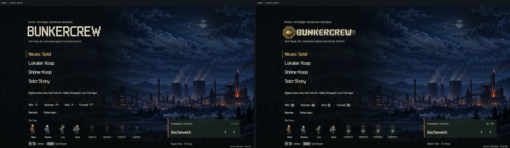

## Charakterauswahl: ganzzahlige Skalierung, 40-Farben-Büsten
`ui.character_select`

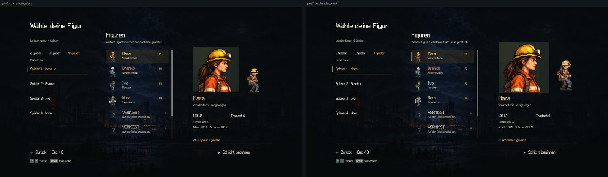

## Werkbank: Vorschau 5×, Reitersymbole 2×
`ui.crafting`

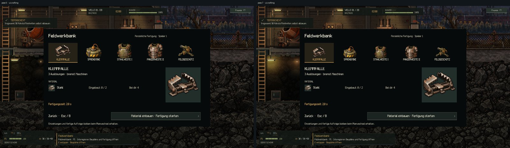

## HUD: WELLE 01 / 20, WOHNTRAKT / 00, Tags ohne Überlappung
`ui.hud_solo_idle`

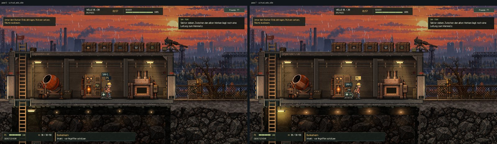

## Kampf hell: Rümpfe, Infanterie und Stationen im Welttexelraster
`combat.wave_bright`

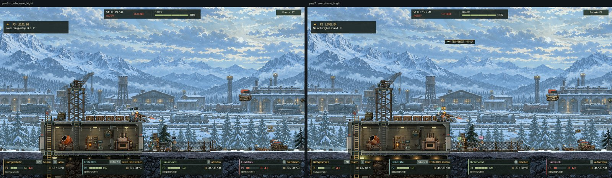

## Kampf Nacht: Spielerfarben, Rümpfe, Licht
`combat.wave_night`

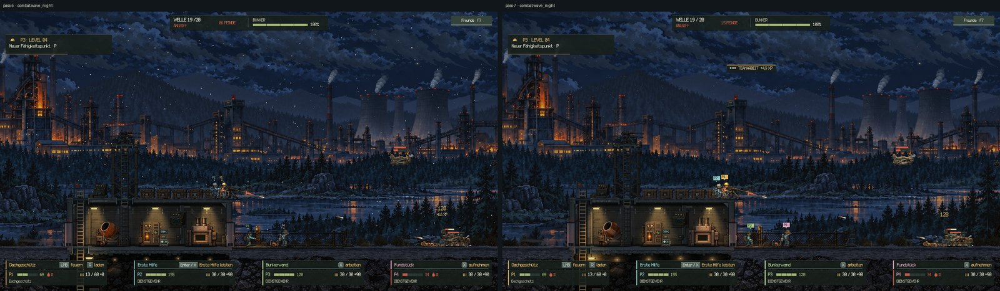

## Flak: Blitz und dunkler Puff statt Feuerball
`combat.flak_fire`

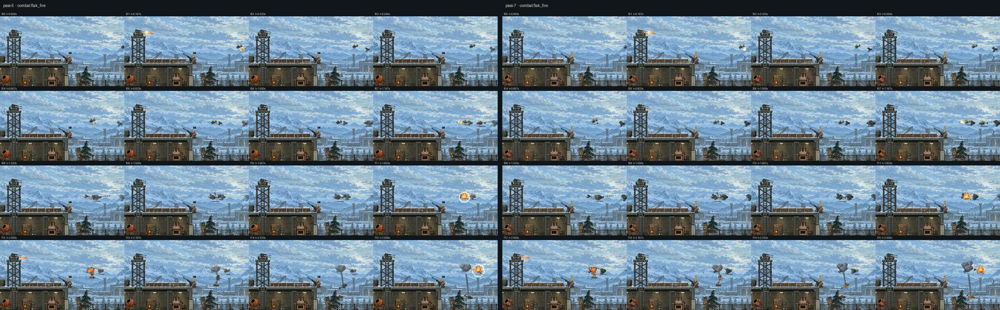

## Infanterie: eigene Silhouette je Rolle, in Welttexeln
`actors.enemies.infantry`

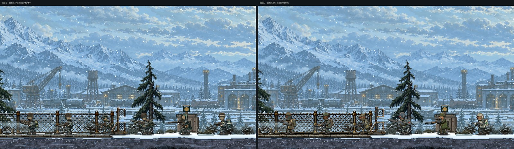

## Flugzeuge: gebackene Rümpfe und gezeichnete Pods
`actors.enemies.aircraft.1`

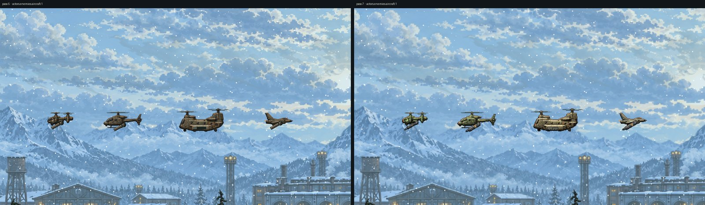

## Schild als Pixel-Energiefeld
`actors.enemies.aircraft.2`

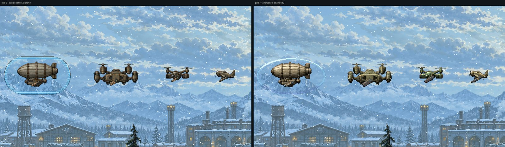

## Fahrzeuge: Rümpfe und Geschütze in Welttexeln
`actors.enemies.vehicles`

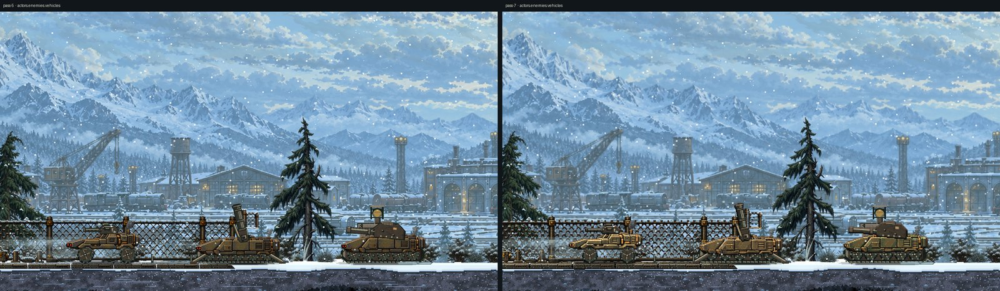

## Stationen in Welttexeln gebacken
`actors.stations.production`

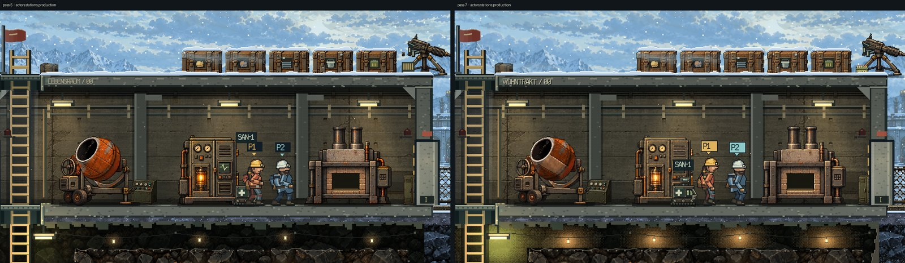

## Untergrund: keine Streifen mehr im Gestein
`world.frozen_rail_yard.underground`

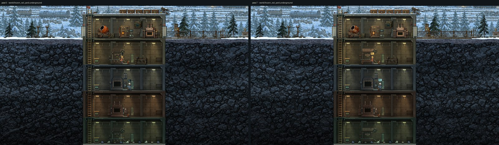

## Blitz mit allen Ästen im Pixelraster
`world.mountain_pass.storm`

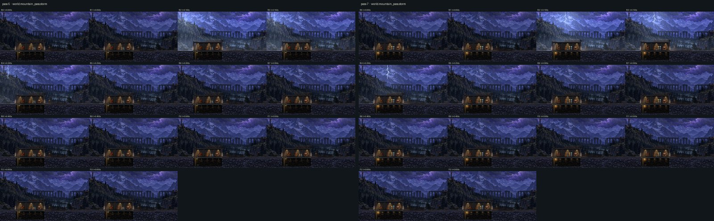

## Treffer: Aufprallpose und Erholung
`motion.worker.hit`

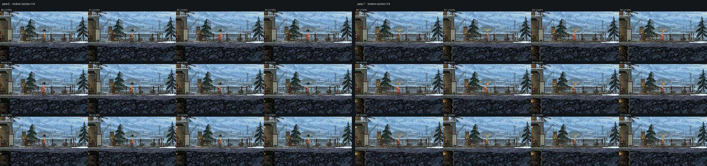

## Zusammenbruch, Knien neben dem Körper, Aufstehen
`motion.worker.revive`

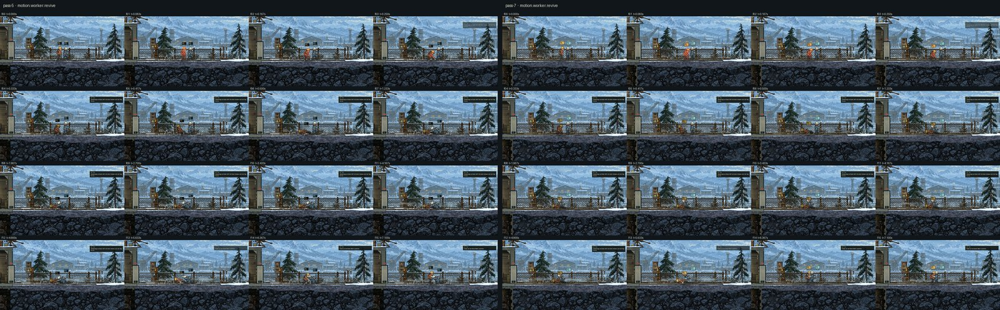

## Infanterie: Fallposen und liegender Körper statt Kiste
`motion.infantry.die`

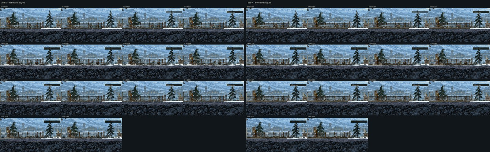

## Panels steigen über dem gedimmten Spiel auf, ohne Schwarzblende
`ui.seq.panel_open_close`

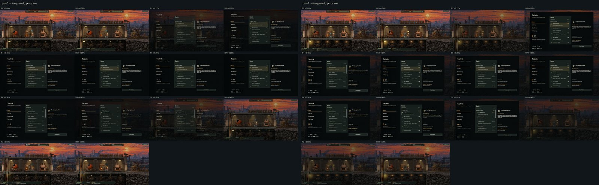
